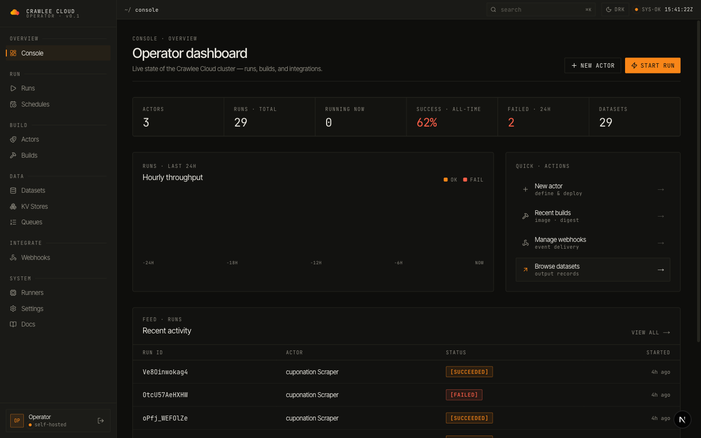
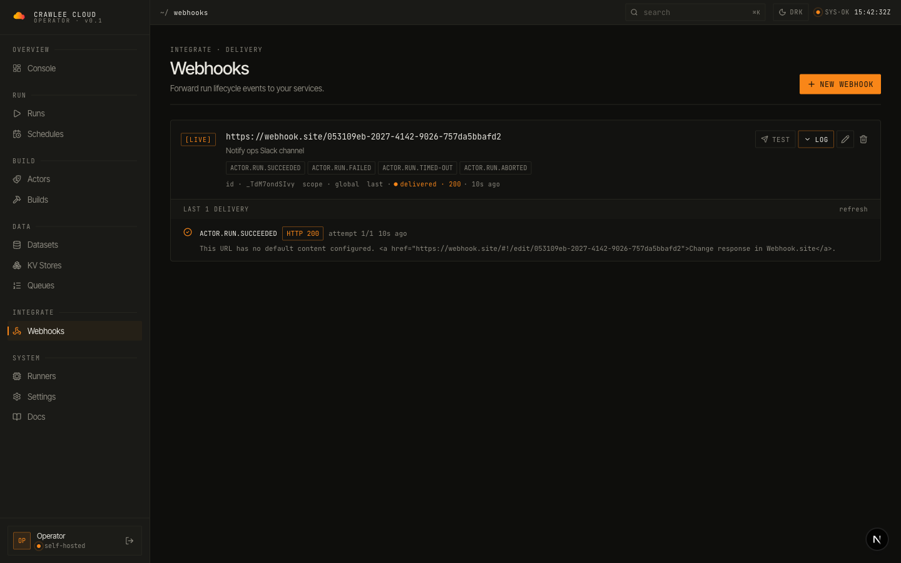
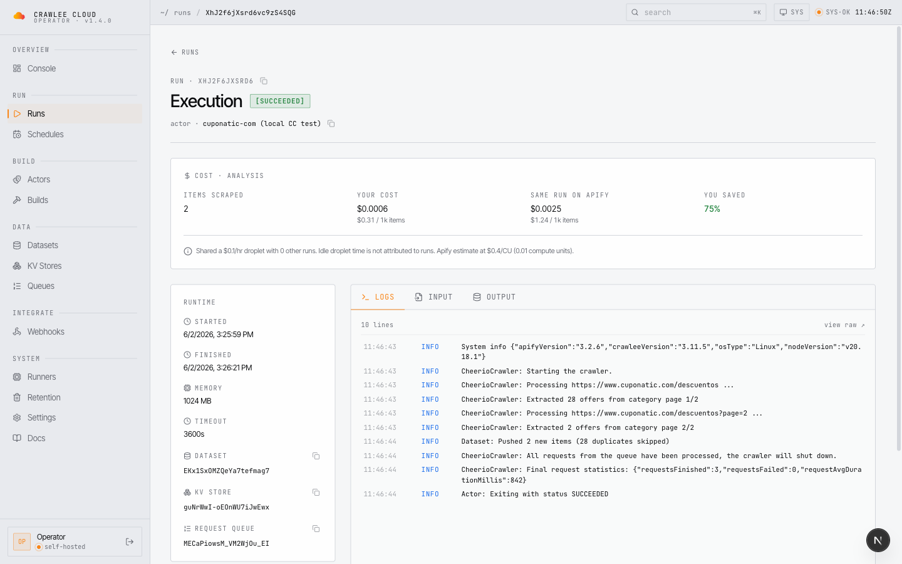
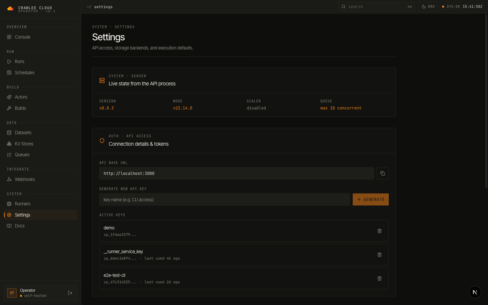
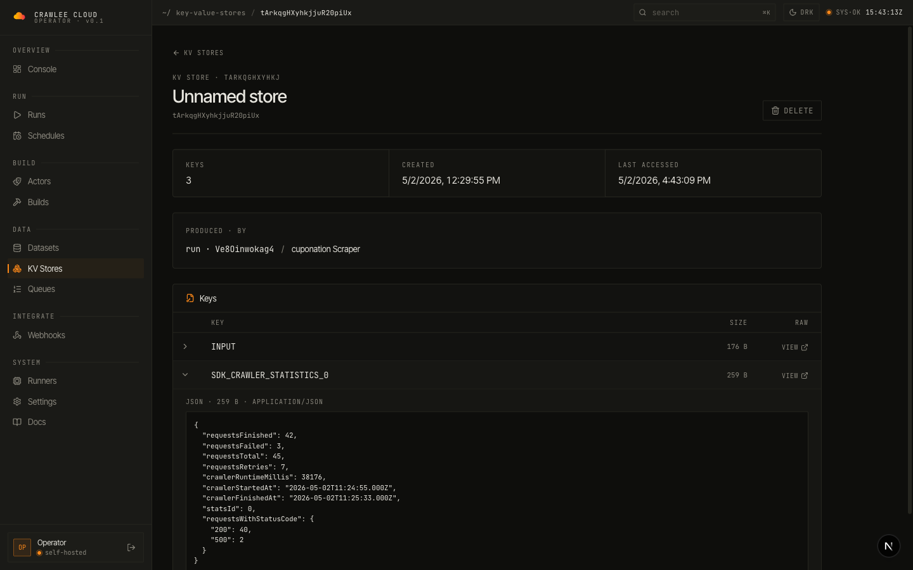
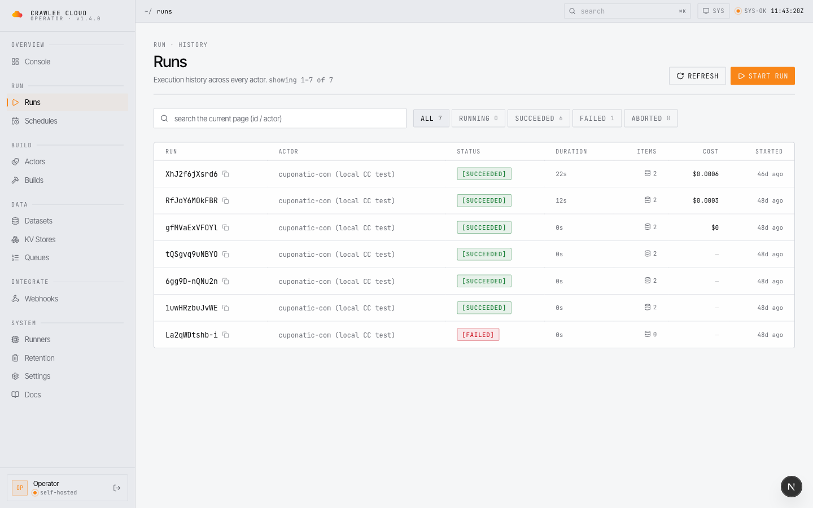
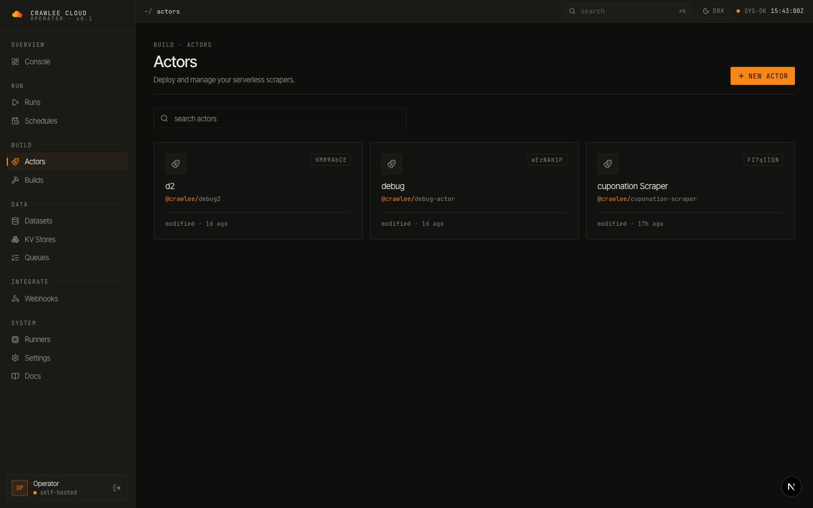

<div align="center">

  <picture>
    <source media="(prefers-color-scheme: dark)" srcset="./logo-dark.svg">
    <source media="(prefers-color-scheme: light)" srcset="./logo-light.svg">
    
  </picture>

**Self-hosted, open-source platform for running Apify Actors on your own infrastructure.**

[](LICENSE)
[](https://www.npmjs.com/package/@crawlee-cloud/cli)
[](https://www.typescriptlang.org/)
[](https://nodejs.org/)

[Dashboard](#dashboard) · [Quick Start](#quick-start) · [Documentation](#documentation) · [Community](#community--support) · [Contributing](#contributing)

</div>

---

## Dashboard

A purpose-built operator console — monitor runs in real time, debug webhook deliveries, browse datasets, and triage failures without leaving the page.

<p align="center">
  
  <br/>
  <em>Operator dashboard — actor count, runs, success rate, hourly throughput, recent activity feed</em>
</p>

<table>
<tr>
<td width="50%">

<p align="center"><em>Webhooks — fire test events per subscription, inline delivery log with HTTP code + body, last-seen status</em></p>
</td>
<td width="50%">

<p align="center"><em>Run detail — cost analysis vs Apify, live logs, container runtime, dataset / KV / queue IDs</em></p>
</td>
</tr>
<tr>
<td width="50%">

<p align="center"><em>Settings — live version, scaler state, storage health probes (PG / Redis / S3) with latency, API keys</em></p>
</td>
<td width="50%">

<p align="center"><em>KV stores — click any record to pretty-print its JSON inline, no new tab needed</em></p>
</td>
</tr>
<tr>
<td width="50%">

<p align="center"><em>Runs — full execution history with status filters, durations, dataset links, per-run cost</em></p>
</td>
<td width="50%">

<p align="center"><em>Actors — your deployed scrapers with version + last-modified at a glance</em></p>
</td>
</tr>
</table>

---

## Why Crawlee Cloud?

Love the Crawlee/Apify ecosystem but want the freedom to run things your way? Crawlee Cloud brings the same great developer experience to your own infrastructure. Keep using the tools you love — just host them wherever you want.

### Key Benefits

- **🏠 Your infrastructure** — Deploy on your own servers, cloud, or anywhere you like
- **🔒 Complete privacy** — Your data stays exactly where you want it
- **⚡ SDK compatible** — Works seamlessly with the Apify SDK you already know
- **🐳 Container-based** — Each Actor runs in an isolated Docker container
- **📊 Beautiful dashboard** — Monitor runs, explore datasets, manage everything visually
- **💰 Cost transparency** — See what each run actually cost you vs what Apify would have charged, per run and at a glance across the runs list

---

## How It Works

```bash
# Instead of pointing to Apify's servers...
export APIFY_API_BASE_URL=https://api.apify.com/v2

# Point to your own Crawlee Cloud instance
export APIFY_API_BASE_URL=https://your-server.com/v2
export APIFY_TOKEN=your-token
```

Your existing Actor code works without any modifications:

```typescript
import { Actor } from 'apify';

await Actor.init();
await Actor.pushData({ title: 'Scraped data' });
await Actor.exit();
```

---

## Quick Start

### Prerequisites

- Node.js 20+
- Docker & Docker Compose
- PostgreSQL, Redis, and S3-compatible storage (or use our Docker setup)

### 1. Clone & Install

```bash
git clone https://github.com/crawlee-cloud/crawlee-cloud.git
cd crawlee-cloud
npm install
```

### 2. Start Infrastructure

```bash
# Starts PostgreSQL, Redis, and MinIO
npm run docker:dev
```

### 3. Configure Environment

```bash
cp .env.example .env
# Edit .env with your settings
```

### 4. Build & Run

```bash
npm run build
npm run db:migrate
npm run dev
```

The API server starts at `http://localhost:3000`.

---

## Deploy

Deploy your own instance in minutes:

| Method                                                                                                                                                                               | Status         | Description                                                            |
| ------------------------------------------------------------------------------------------------------------------------------------------------------------------------------------ | -------------- | ---------------------------------------------------------------------- |
| [](https://cloud.digitalocean.com/apps/new?repo=https://github.com/crawlee-cloud/crawlee-cloud/tree/main&refcode=crawlee) | ✅ Supported   | Automated full stack — App Platform, managed PG/Redis, Runner Droplet  |
| [VPS Deploy Script](deploy/vps/)                                                                                                                                                     | ✅ Supported   | Full stack on any Ubuntu VPS with auto-HTTPS via Caddy                 |
| Railway                                                                                                                                                                              | 🚧 Coming soon | One-click PaaS deploy (template scaffolding present, not yet verified) |
| Render                                                                                                                                                                               | 🚧 Coming soon | One-click PaaS deploy (blueprint present, not yet verified)            |

See [deploy/](deploy/) for detailed instructions.

---

## Architecture

```
┌─────────────────────────────────────────────────────────────────┐
│                        Your Actors                              │
│            (using official Apify SDK, no changes)               │
└────────────────────────────┬────────────────────────────────────┘
                             │
                             ▼
┌─────────────────────────────────────────────────────────────────┐
│                     Crawlee Cloud API                           │
│              (Apify-compatible REST endpoints)                  │
└─────────────────────────────────────────────────────────────────┘
        │                    │                    │
        ▼                    ▼                    ▼
   ┌──────────┐         ┌─────────┐         ┌─────────┐
   │PostgreSQL│         │  Redis  │         │ S3/MinIO│
   │ metadata │         │ queues  │         │  blobs  │
   └──────────┘         └─────────┘         └─────────┘
```

### Components

| Component      | Description                                                 |
| -------------- | ----------------------------------------------------------- |
| **API Server** | Fastify-based REST API compatible with Apify's v2 endpoints |
| **Runner**     | Polls job queue and executes Actors in Docker containers    |
| **Dashboard**  | Next.js web UI for monitoring and management                |
| **CLI**        | Command-line tool for pushing and running Actors            |

---

## Documentation

| Guide                                                                 | Description                                  |
| --------------------------------------------------------------------- | -------------------------------------------- |
| [API Reference](https://crawlee.cloud/docs/api)                       | REST API endpoints and usage                 |
| [CLI Guide](https://crawlee.cloud/docs/cli)                           | Command-line interface                       |
| [Dashboard](https://crawlee.cloud/docs/dashboard)                     | Web interface overview                       |
| [Deployment](https://crawlee.cloud/docs/deployment)                   | Production deployment guide                  |
| [Runner](https://crawlee.cloud/docs/runner)                           | Actor execution engine                       |
| [SDK Compatibility](https://crawlee.cloud/docs/apify-sdk-environment) | Apify SDK integration                        |
| [MCP (AI agents)](docs/mcp.md)                                        | Connect Claude, Cursor and other MCP clients |

---

## Supported Apify SDK Features

| Feature                                      | Status       |
| -------------------------------------------- | ------------ |
| Datasets (`Actor.pushData`)                  | ✅ Supported |
| Key-Value Stores (`Actor.getValue/setValue`) | ✅ Supported |
| Request Queues                               | ✅ Supported |
| Request deduplication                        | ✅ Supported |
| Distributed locking                          | ✅ Supported |
| Builds & versioning                          | ✅ Supported |
| Webhooks                                     | ✅ Supported |
| Schedules                                    | ✅ Supported |
| Auto-scaling runners (local Docker, GHCR)    | ✅ Supported |

---

## What's New

**v1.7.0** — MCP support for AI agents through Apify API parity. The stock Apify MCP server (`@apify/actors-mcp-server`) now works unmodified against your instance: point its `APIFY_API_BASE_URL` at your API, and Claude Desktop, Claude Code, Cursor and other MCP clients can search, run and inspect your actors and read their datasets and key-value stores ([setup](docs/mcp.md)). The same work makes plain `apify-client` behave as it does on Apify: `/v2/actors` paths, `username~name` actor IDs, `actor.call(input)` keeping its input (see the [run-start contract](docs/apify-compatibility.md#run-start-contract)), `waitForFinish` long-polling, default builds with input schemas, `GET /v2/store`, and dataset `fields`/`omit`/`desc`. It also fixes two cross-user leaks: webhooks now fire only for their owner's runs, and actor version and build routes are scoped to the caller. The API also no longer crashes when Postgres drops a pooled connection (failover, restart). Several API responses change shape; see the [full changelog](CHANGELOG.md#170---2026-11-09).

The 1.1–1.6 line that led here covered: the zombie-run reliability overhaul from a live production incident — Redis-blip-proof dead-runner detection, a zombie-run reaper, OOM kills made visible, failed-run logs archived to KV, prebuilt runner images cutting ~4.5 min off scale-up (v1.1.x); memory-aware placement, fast dead-runner reap, and the claim-time cost-attribution stamps (v1.2.0); ingest hot-path performance and runner-key self-healing (v1.2.1/1.2.2); the run-details cost analysis card (v1.3.0); per-run cost across the runs list, backed by the batch cost endpoint `GET /v2/actor-runs/costs` (v1.4.0); and safe actor force-deletion, webhook SSRF loopback fixes, the first enforced test-coverage floors in CI (v1.5.0); and runner disk-pressure protection with full-dataset streaming on no-limit dataset reads (v1.6.0).

> **Upgrading from v1.6.0 to v1.7.0** needs a database migration, and compose installs need a one-time MinIO volume ownership fix: back up the MinIO volume and apply the fix from the Self-hosting entry of the [1.7.0 changelog](CHANGELOG.md#170---2026-11-09) before starting the new stack. Migrations do not run on startup: run them right after the new API is up (`docker compose exec api node packages/api/dist/db/migrate.js`, or `npm run db:migrate`), since routes that read the new columns fail until you do; if the API logged a `[Setup]` failure before the migration ran, restart it once. The `users.username` migration is one-way: it backfills a slug for every user and sets the column `NOT NULL`, so after rolling back to 1.6.x, that API cannot create users until you run `ALTER TABLE users ALTER COLUMN username DROP NOT NULL`. The CLI and dashboard can be upgraded in any order: they check `GET /health` and keep sending the legacy run-start body to APIs older than 1.7.0. After rolling the API back, reload open dashboard tabs, since the dashboard checks the API version once per page load. The API behaviour changes are listed at the top of the [1.7.0 changelog](CHANGELOG.md#170---2026-11-09). From v1.5.0 or earlier, walk the [CHANGELOG](CHANGELOG.md) forward — deploy notes are flagged inline at each release.

---

## Community & Support

Crawlee Cloud is young, and feedback from real deployments shapes what gets built next.

- **💬 [GitHub Discussions](https://github.com/crawlee-cloud/crawlee-cloud/discussions)** — ask questions, share what you're running, weigh in on the roadmap
- **🚀 [Deployed it? Tell us how it went](https://github.com/crawlee-cloud/crawlee-cloud/issues/new?template=deployment_report.yml)** — 5 minutes of honest notes about your deploy experience is the most useful thing an early user can send
- **🤝 Free 15-minute setup help** — stuck deploying? [Email me](mailto:aminembarki@gmail.com?subject=crawlee-cloud%20setup%20help) and I'll personally help you get running, free, in exchange for your candid feedback
- **☕ Support the project** — [Open Collective](https://opencollective.com/crawlee-cloud) · [GitHub Sponsors](https://github.com/sponsors/aminembarki) · [Ko-fi](https://ko-fi.com/crawleecloud)

---

## Contributing

We welcome contributions! Please see our [Contributing Guide](CONTRIBUTING.md) for details.

```bash
# Run tests
npm test

# Type checking
npm run typecheck

# Linting
npm run lint
```

---

## Supported by

Crawlee Cloud's infrastructure is generously supported by DigitalOcean through their [Open Source Credits Program](https://www.digitalocean.com/open-source/credits-for-projects).

<div align="center">

[](https://www.digitalocean.com/?refcode=ce0e27c04a52&utm_campaign=Referral_Invite&utm_medium=Referral_Program&utm_source=badge)

</div>

---

## License

This project is licensed under the [MIT License](LICENSE).

---

<div align="center">

**Built with ❤️ for the web scraping community**

</div>
