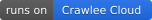

# "Runs on Crawlee Cloud" badge

If your Actor runs on a self-hosted Crawlee Cloud instance, you can say so in its README.



## Add it to your README

```markdown
[](https://github.com/crawlee-cloud/crawlee-cloud)
```

## Tell people how to run it

A badge is more useful with the three commands that back it up. Paste this under it and adjust the URL:

````markdown
### Run on your own Crawlee Cloud

```bash
npm install -g @crawlee-cloud/cli
crawlee-cloud login --url https://crawlee.example.com --token <your-api-key>
crawlee-cloud push && crawlee-cloud call <actor-name> --wait
```
````

The Actor code does not change: it uses the standard Apify SDK, which talks to whichever API `APIFY_API_BASE_URL` points at. See the [Quick Start Tutorial](./quickstart-tutorial.md) for a full walkthrough and [Apify API Compatibility](./apify-compatibility.md) for what is and is not supported.

## Using the badge

The badge says an Actor works on Crawlee Cloud. It does not imply endorsement by, or affiliation with, Apify.
